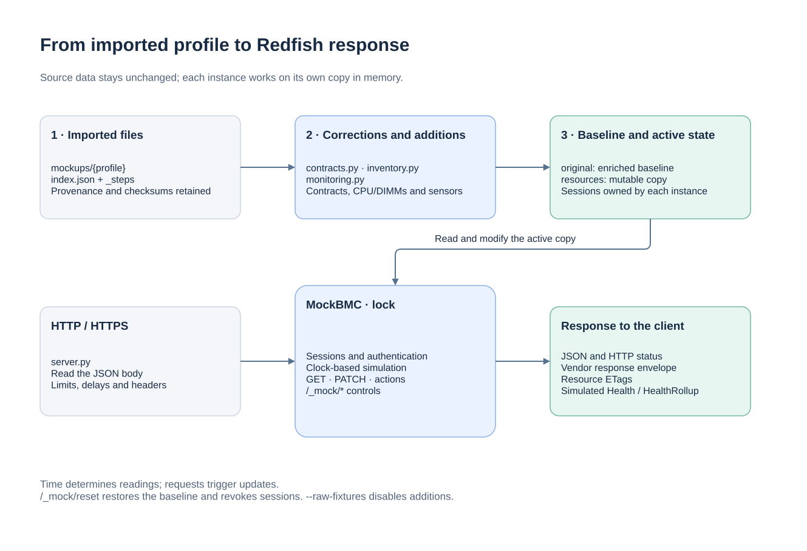

# Architecture

[Documentation](README.md) · [API](API.md) · [Development](DEVELOPMENT.md)

## Overview

Each BMC is a `MockBMC` object served by a minimal `RedfishASGI` adapter
and one Uvicorn worker. Multiple worker processes are intentionally unsupported
because sessions and mutable state live in memory.
With Docker, the three profiles run in separate containers. With `--fleet`,
they share a Python process but retain independent servers, ports, locks,
resources and sessions.

[Draw.io source](assets/architecture.drawio).

## Modules and responsibilities

| File | Responsibility |
|---|---|
| [`__main__.py`](../redfish_mock/__main__.py) | Options, environment, single-profile or fleet startup, TLS, shutdown |
| [`server.py`](../redfish_mock/server.py) | HTTP transport, JSON, body size, delays, status codes and headers |
| [`engine.py`](../redfish_mock/engine.py) | Resources, authentication, sessions, GET/PATCH/actions and mock controls |
| [`contracts.py`](../redfish_mock/contracts.py) | Contract corrections, writable fields and vendor-specific envelopes |
| [`inventory.py`](../redfish_mock/inventory.py) | Generation of the two CPUs and installed DIMMs for each profile |
| [`monitoring.py`](../redfish_mock/monitoring.py) | Sensors, ECC counters, scenarios, standby and health propagation |
| [`simulation.py`](../redfish_mock/simulation.py) | Bounded variations over time, seed and power window |
| [`monitor.py`](../redfish_mock/monitor.py) | Example of read-only HTTP collection and KPI calculation |

## Data origin and lifecycle

At startup, the engine reads `index.json` files from `mockups/{profile}`.
Their paths become URIs under `/redfish/v1`. The `_steps/*.json` files are
loaded separately for optional task and service progression.

The default mode applies contract corrections, then adds inventory and
monitoring data to known profiles. This enriched baseline is kept in
`original`. A copy becomes `resources`, the mutable active state. Imported
JSON files remain unchanged. Their provenance, MIT license and integrity
checks are described in [SOURCES.md](SOURCES.md).

The supplied dataset contains 256 `index.json` resources and 11 sequence
steps. Corrections and additions produce the following counts at startup,
before any sessions are created:

| Profile | Imported resources | Served resources | Sequence steps |
|---|---|---|---|
| Dell | 70 | 104 | 3 |
| HPE | 58 | 94 | 5 |
| Supermicro | 39 | 68 | 0 |
| Lenovo | 58 | 58 | 3 |
| HPE iLO 4 | 31 | 31 | 0 |

Added resources cover CPU/DIMM inventories and memory metrics for the three
main profiles, plus a Supermicro log collection. Lenovo and HPE iLO 4 remain
optional regression profiles.

`POST /_mock/reset` copies the baseline, resets sequence positions, removes
sessions and restarts the `baseline` scenario. Restarting the process reloads
the files and chooses a new seed if none is supplied. There is no database
or application persistence volume.

`--raw-fixtures` disables corrections and additions. It retains the HTTP
engine rules and write restrictions: it is not a more complete firmware
emulation. Custom inventories are enriched only when their compatibility
conditions are met; see [INVENTORY.md](INVENTORY.md).

## Request processing

1. Uvicorn parses HTTP/1.1 with h11 and enforces a concurrency limit of 64.
   The adapter reads JSON bodies within 10 seconds, limits them to 1 MiB and
   rejects chunked bodies. Blocking engine operations run off the event loop.
2. The engine normalizes the path and acquires the instance lock.
3. Expired sessions are removed; protected routes check Basic authentication
   or `X-Auth-Token`.
4. The simulation computes the sample for the elapsed time if a new interval
   has started.
5. The engine performs the read, expansion, permitted write, action or
   mock control operation.
6. The response is serialized as JSON; the transport adds headers including
   `OData-Version: 4.0`, `Cache-Control: no-store` and the body length.

The lock protects mutations and resource reads. It does not create a
transaction spanning multiple collector requests: two reads across an
interval boundary may observe two different samples. Resource ETags are
based on their JSON content.

## Availability and logs

Startup loads every selected profile and reserves every socket before serving.
A failed fleet startup closes all reserved sockets and exits unsuccessfully.
`/readyz` becomes available after ASGI initialization and is marked unavailable
when shutdown begins. SIGTERM stops acceptance and drains requests for up to
15 seconds. Compose allows 20 seconds before forced termination.

Request logs are JSON with profile, method, sanitized path, status and duration.
They omit query strings, credentials, bodies and session identifiers. Forwarded
headers are ignored unless an explicit IP/CIDR trust list is configured.

## Time-based simulation

There is no dedicated sensor loop. The engine uses a monotonic clock during
requests. The sample index depends on elapsed time, not the number of GETs.
Pseudo-random targets are determined by the seed, profile, scenario, power
state and series involved.

Interpolation between targets avoids fully independent jumps. Power,
temperature and fan speed share a load component; each temperature also has
a small independent variation. Faults, absent sensors and unavailable
readings are preserved.

The power window is reconstructed from the same deterministic samples over
at most 300 seconds. Its computation remains bounded even after a long period
without collection. Details of ranges, counters and transitions are in
[MONITORING.md](MONITORING.md).

## Functional boundaries

The example collector communicates over HTTP and follows Redfish links;
it does not access the server's Python state. The `/_mock/*` routes belong
to the test environment and must not be used as a real BMC API.

The `_steps` sequences are independent of actions and time-based simulation.
`--play-sequences` advances a sequence on GET, not HEAD. A reset restores
their initial position. They are not an asynchronous firmware task system.
