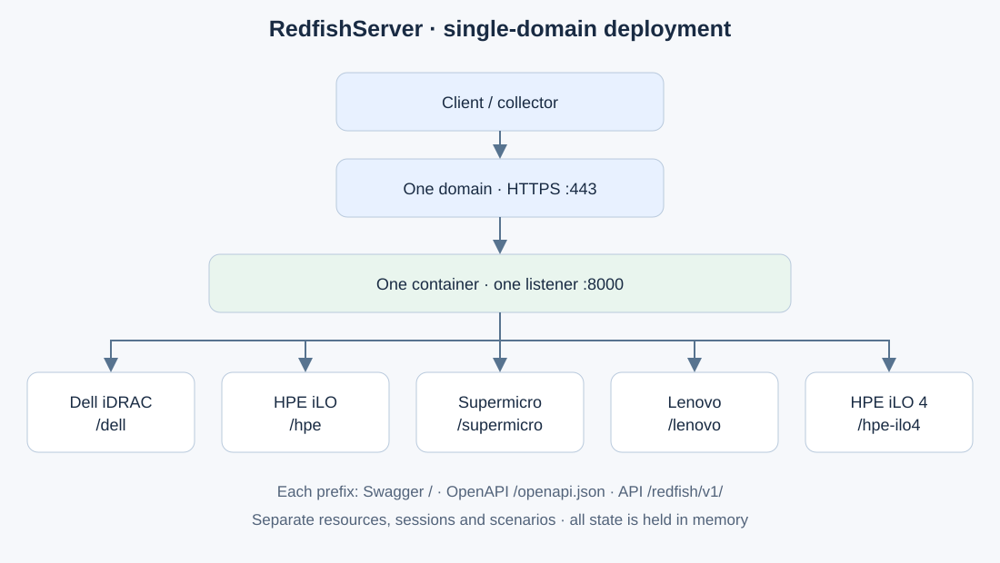

# Deployment and operations

[Documentation](README.md) · [API](API.md) · [Monitoring](MONITORING.md)

Run commands from the project root. Choose Docker or Python for a given port
range: both modes cannot use it simultaneously.

For internal production delivery, follow [PRODUCTION.md](PRODUCTION.md).
This guide describes local development and the complete CLI.

## Docker Compose

Prerequisites: a running Docker engine and the `docker compose` command.
Building may require registry access to download the base Python image.

```sh
docker compose up --build -d --wait
docker compose ps
curl http://127.0.0.1:8001/healthz
```

Compose starts Dell on 8001, HPE on 8002 and Supermicro on 8003. Each container
listens internally on 8000. The image runs Python 3.14 as a non-root user;
the filesystem is read-only, capabilities are dropped and the process count
is limited.



[Draw.io source](assets/deployment.drawio).

To add the two regression profiles:

```sh
docker compose --profile extras up --build -d --wait
# Lenovo: 8004; HPE iLO 4: 8005
```

To read logs, update or stop:

```sh
docker compose logs --tail=100 dell hpe supermicro
docker compose up --build -d --wait
docker compose --profile extras down
```

Recreating or stopping an instance loses changes held in memory and sessions.
HTTP logs do not record authentication headers or request bodies.

## Docker configuration

Create `.env` from [`.env.example`](../.env.example) if it does not already
exist, then set the values you need. Edit an existing `.env` file instead of
blindly replacing it. Git ignores this file.

| Variable | Default | Effect |
|---|---|---|
| `REDFISH_USERNAME` | `admin` | Username for all Compose instances |
| `REDFISH_PASSWORD` | `admin` | Password for the instances |
| `REDFISH_BIND_ADDRESS` | `127.0.0.1` | Host interface on which ports are published |
| `REDFISH_METRIC_INTERVAL` | `5` | Simulation step, an integer from 1 to 60 seconds |
| `REDFISH_SEED` | empty | Optional integer seed; otherwise chosen at each startup |

After editing, run `docker compose up -d --wait`. A simple
`docker compose restart` does not reload Compose configuration changes.

To collect from another machine, set `REDFISH_BIND_ADDRESS` to a local LAN
address or `0.0.0.0`, then use `http://ADDRESS:8001`, `:8002` or `:8003` from
the collector. The supplied Compose configuration uses HTTP. The Python mode
below provides HTTPS directly for lab use.

## Running with Python

Prerequisites: Python 3.14 and `uv`. `uv run --frozen` installs the locked
Uvicorn runtime and development dependencies.

```sh
uv run --frozen python -m redfish_mock --fleet
# Or a single profile on a chosen port:
uv run --frozen python -m redfish_mock --vendor hpe --port 8010
```

The fleet uses `--port`, `--port + 1` and `--port + 2`. `Ctrl+C` or SIGTERM
stops the servers. All ports are reserved before threads start.

| Option | Default | Purpose |
|---|---|---|
| `--vendor` | `dell` | `dell`, `hpe`, `supermicro`, `lenovo`, `hpe-ilo4` |
| `--fleet` | disabled | Starts the three main profiles; mutually exclusive with `--vendor` |
| `--host` / `--port` | `127.0.0.1` / `8001` | Interface and first port |
| `--username` / `--password` | environment, otherwise `admin` | Mock credentials |
| `--production` | disabled | Requires authentication, explicit credentials and a non-default password |
| `--password-file` | `REDFISH_PASSWORD_FILE` | Read a UTF-8 password from a mounted secret |
| `--trusted-proxies` | `REDFISH_TRUSTED_PROXIES`, otherwise empty | Explicit IP/CIDR list allowed to supply forwarded headers |
| `--no-auth` | disabled | Disables authentication for testing |
| `--session-timeout` | `1800` | Session expiration after inactivity, in seconds |
| `--metric-interval` | environment, otherwise `5` | Simulation step from 1 to 60 seconds |
| `--seed` | environment, otherwise random | Reproducible trajectory at the same elapsed time |
| `--static-metrics` | disabled | Fixed values; scenarios remain available |
| `--raw-fixtures` | disabled | Imported data without corrections or additions |
| `--mockups-dir` | project `mockups/` | Parent directory of custom profiles |
| `--play-sequences` | disabled | Advances `_steps` files on each relevant GET |
| `--delay-ms` | `0` | Added response latency, from 0 to 60,000 ms |
| `--cert` / `--key` | none | Pair of PEM files for HTTPS |
| `--quiet` | disabled | Reduces server logging |

In Python mode, `REDFISH_USERNAME`, `REDFISH_PASSWORD`,
`REDFISH_METRIC_INTERVAL` and `REDFISH_SEED` come from the process environment.
The program does not automatically load `.env`. Explicit arguments take
precedence except for passwords: configuring more than one password source
(CLI password, CLI file, environment password or environment file) is an error.
Password files must be non-empty UTF-8, at most 64 KiB; one trailing newline is
removed. Never put secrets in command arguments for production. `REDFISH_BIND_ADDRESS` is specific to Compose; Python uses `--host`.

## Local HTTPS

First stop any instances occupying the same ports. Generate a lab certificate,
then start the fleet:

```sh
mkdir -p certs
openssl req -x509 -newkey rsa:2048 -nodes -days 30 \
  -subj '/CN=localhost' -addext 'subjectAltName=DNS:localhost,IP:127.0.0.1' \
  -keyout certs/key.pem -out certs/cert.pem
uv run --frozen python -m redfish_mock --fleet --cert certs/cert.pem --key certs/key.pem
```

```sh
curl --cacert certs/cert.pem -u admin:admin https://localhost:8001/redfish/v1/Systems
uv run --frozen python -m redfish_mock.monitor --url https://localhost:8001 --ca-file certs/cert.pem
```

For another DNS name or a LAN address, adjust the certificate SANs and `--host`.
The certificate must match the address used. The collector verifies TLS and
rejects redirects and links to another host. The Compose health check uses
HTTP; the HTTPS procedure above applies to Python.

## Checks and troubleshooting

| Symptom | Check / resolution |
|---|---|
| Port already in use | Stop the other launch mode or choose another Python port range |
| 401 | Check Basic authentication and effective environment variables, or renew the session after a reset |
| Redfish health is `Critical`, health check is `ok` | Dataset fault; inspect PSUs, fans, temperatures and storage |
| Values appear fixed | Check `GET /_mock`, wait at least one interval, and check raw/static modes |
| `normal` remains `Warning` or `Critical` | Initial storage/VBAT faults are preserved |
| 409 when selecting a scenario | Power the system on using the Redfish action before changing scenarios |
| 412 on PATCH | Read the resource again and use its current ETag; readings may change |
| 501 on an action | Action or mode not implemented; see [API.md](API.md) |
| TLS error | Check the trusted authority and the name in the certificate |
| Remote collection fails | Check the published address, destination address and network access to the port |

The smoke test requires explicit targets and permission to reset:

```sh
make smoke ARGS="--url dell=http://127.0.0.1:8001 --allow-reset"
```

**It resets the tested instances and revokes their sessions**; use it only on
disposable instances. `make verify` creates and removes isolated instances
instead. Development checks are described in [DEVELOPMENT.md](DEVELOPMENT.md).
