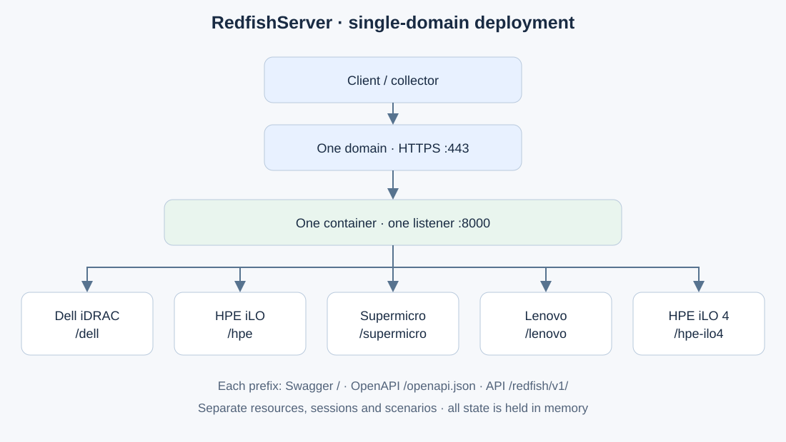

# Redfish mock documentation

This project simulates Dell iDRAC, HPE iLO and Supermicro BMCs for developing
and testing a Redfish client, inventory collection or monitoring. It serves
HTTP/HTTPS resources, accepts selected writes and varies readings within
bounded ranges. The engine uses Python 3.14 with Uvicorn for its ASGI transport.

The data is **synthetic**. The targeted contracts are based on vendor
documentation; no validation on real hardware is claimed.

## Reading guide

| Need | Guide |
|---|---|
| Prepare a validated internal production delivery | [Production and release](PRODUCTION.md) |
| Start the server; configure Docker/Python, HTTPS or remote access | [Deployment and operations](DEPLOYMENT.md) |
| Understand the modules, data and request processing | [Architecture](ARCHITECTURE.md) |
| Discover resources, authenticate and run actions | [API and examples](API.md) |
| Collect power, temperatures and KPIs; choose a scenario | [Monitoring and simulation](MONITORING.md) |
| Check CPU and DIMM configurations and population rules | [Inventories](INVENTORY.md) |
| Review official sources, corrections and limitations | [Fidelity](FIDELITY.md) |
| Find the origin and license of imported files | [Provenance and integrity](SOURCES.md) |
| Modify the project, verify changes and maintain diagrams | [Development](DEVELOPMENT.md) |
| Open Draw.io sources or re-export SVGs | [Diagram catalog](assets/README.md) |

## Get started in three commands

From the project root, with Docker Compose available:

```sh
docker compose up --build -d --wait
curl -u admin:admin http://127.0.0.1:8001/redfish/v1/Systems
uv run --frozen python -m redfish_mock.monitor --url http://127.0.0.1:8001
```

The last command requires Python locally. It displays a JSON snapshot of the
KPIs; it does not install a Prometheus exporter or a dashboard.

| Active profile | Local port | Model | CPU / RAM |
|---|---|---|---|
| `dell` | 8001 | PowerEdge R750 | 2 × Gold 6338 / 512 GiB |
| `hpe` | 8002 | ProLiant DL380 Gen10 Plus | 2 × Silver 4314 / 256 GiB |
| `supermicro` | 8003 | SYS-6019U-TR4 | 2 × Gold 6230 / 192 GiB |



[Edit this diagram in Draw.io](assets/deployment.drawio).

## Default behavior

Local credentials are `admin` / `admin`. Docker ports are published on
`127.0.0.1`. Each instance has its own state in memory and its own sessions.
Changes are lost on restart.

Readings change every five seconds: power varies by ±10%, and temperatures
and fan speeds are correlated with load. A seed lets you replay the same
trajectory. The `--static-metrics` mode keeps values fixed.

The initial scenario deliberately includes faults: a `Warning` or `Critical`
health status does not mean the mock process has failed. `GET /healthz` checks
the HTTP service; Redfish fields describe **simulated** hardware health.
`POST /_mock/reset` restores the profile and revokes its sessions.

The optional Lenovo and HPE iLO 4 profiles are used for regression testing.
They do not include the CPU/RAM additions or monitoring simulation available
in the three main profiles.

## Scope

The project covers resource discovery, inventories, hardware readings,
sessions, a subset of boot and virtual media operations, and reproducible
scenarios. It does not simulate an OS, real firmware updates, push events or
a historical database. Detailed limitations are listed in
[FIDELITY.md](FIDELITY.md).

[Back to the project overview](../README.md).
