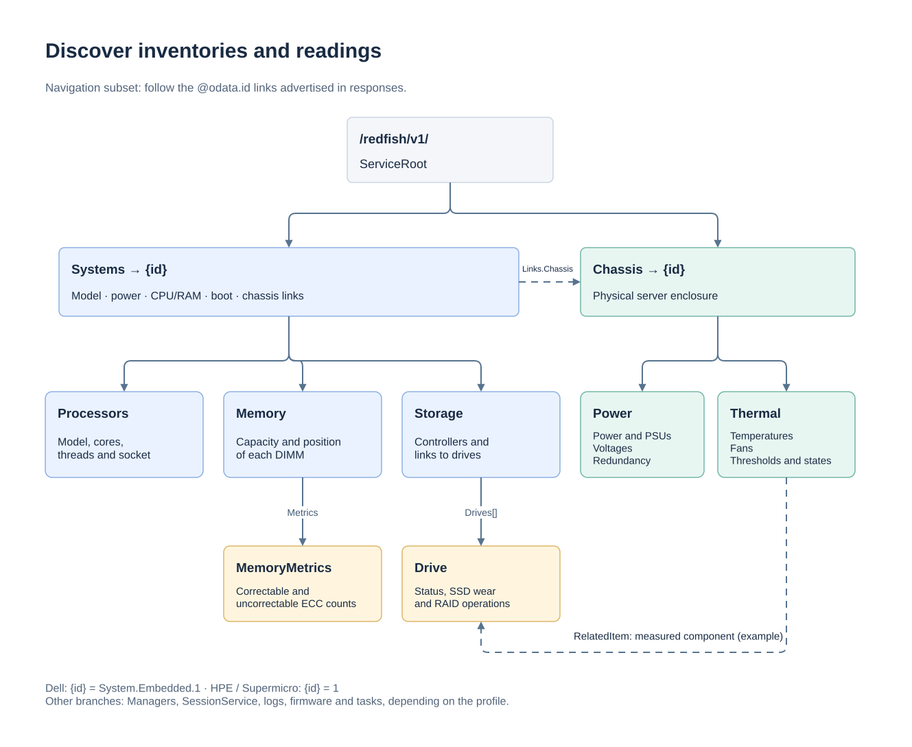

# API and examples

[Documentation](readme.md) · [Deployment](deployment.md) · [Monitoring](monitoring.md)

This reference describes the subset implemented by the mock. A link in a
fixture does not guarantee that all its actions are supported. Examples use
Dell under `/dell` on port 8000 and the default local credentials.

## Interactive documentation

Open the instance root, for example [Dell Swagger](http://127.0.0.1:8000/dell/).
Swagger UI and its assets are bundled locally and work without Internet access.
`GET /dell/openapi.json` exports the OpenAPI 3.1 description for the active profile,
including custom baseline resources and the effect of `--raw-fixtures`.
The domain root `/` is a catalogue; `/<profile>/` opens that profile's Swagger.
Unless an absolute URL is shown, API paths below are relative to the profile
prefix: `/redfish/v1/Systems` means `/dell/redfish/v1/Systems` for Dell.
Returned links and session `Location` headers already include the prefix.
Use `/<profile>/healthz` for the profile JSON status.
GET and HEAD on the page, specification and registered assets are public.

The page is entirely in English and opens directly with Swagger. Its description
contains a responsive vector illustration inspired by the README mascot, with a
prominent **Fake** badge and Swagger's gray/green palette. The SVG fills the available width.
The server uses synthetic data, in-memory changes and partial Redfish coverage. Operations are
grouped by function; **not simulated (501)** actions are explicitly distinguished
from simulated actions. Response schemas describe the mock subset, not the full
DMTF schemas. Examples are synthetic illustrations, not snapshots of active state.
Reading the documentation does not advance telemetry, fixture sequences or sessions.

Select **Authorize** and use either Basic credentials or `X-Auth-Token`.
With the default development credentials (`admin` / `admin`), Basic authorization
is already configured on each Swagger page and **Try it out** works immediately.
This preset is enabled only when that exact pair is valid and authentication is
enabled. Custom credentials and production secrets are never published in the
page or contract; enter them manually in **Authorize**.
To obtain a token, execute `POST /redfish/v1/SessionService/Sessions` with the
configured credentials, then copy the response's `X-Auth-Token` into Authorize.
If both authorization methods are selected, the token takes precedence.
Manually entered authorization is not retained after reloading the page; the
public development preset is reapplied when eligible. In `--no-auth` mode,
ordinary API calls need no authorization; session creation still checks credentials.

**Try it out** sends requests only to the current domain and profile. Writes change its
shared simulated state, and `POST /_mock/reset` revokes all sessions, including the
one used to request the reset. Documentation remains public in production mode;
API authentication and the existing trusted-team access model are unchanged.

## Resource discovery

Start at `/redfish/v1/`, then follow collection `@odata.id` values and member
links. Avoid assuming that identifiers are the same across vendors. In the
supplied profiles, the system and chassis use `System.Embedded.1` for Dell
and `1` for HPE/Supermicro.



[Draw.io source](assets/redfish-resources.drawio).

```sh
curl -u admin:admin http://127.0.0.1:8000/dell/redfish/v1/
curl -u admin:admin http://127.0.0.1:8000/dell/redfish/v1/Systems
curl -u admin:admin http://127.0.0.1:8000/dell/redfish/v1/Systems/System.Embedded.1
```

| Discovered resource | Information |
|---|---|
| `Systems/{id}` | Model, power, CPU/RAM summaries, boot, actions and links |
| `Systems/{id}/Processors` | Collection of installed CPUs |
| `Systems/{id}/Memory` | DIMM collection; each enriched DIMM links to its ECC `Metrics` |
| `Systems/{id}/Storage` | Controllers, volumes and drive links |
| `Chassis/{id}/Power` | Consumption, PSUs, voltages, redundancy and aggregates |
| `Chassis/{id}/Thermal` | Temperatures, fans, thresholds and states |
| `Managers` | BMC, firmware, media and links available in the profile |
| `LogServices` / `Entries` | Predefined logs under their respective owners |

Embedded sensors may have a fragment URI, such as
`.../Power#/PowerSupplies/0`. The fragment is not an HTTP route: retrieve
`.../Power`, then resolve `/PowerSupplies/0` in the JSON document.
`RelatedItem` links new sensors to the measured component.

## Authentication

GET/HEAD requests to `/`, `/openapi.json`, registered `/assets/swagger-ui/` files,
`/healthz`, `/readyz`, `/redfish` and `/redfish/v1/` are public.
Other resources require Basic authentication or a token, except in `--no-auth`
mode. Session creation checks the credentials in the JSON body:

```sh
curl -i -H 'Content-Type: application/json' \
  -d '{"UserName":"admin","Password":"admin"}' \
  http://127.0.0.1:8000/dell/redfish/v1/SessionService/Sessions
```

Success returns **201**, `X-Auth-Token` and `Location`. Use the token in the
`X-Auth-Token` header for subsequent requests, then send DELETE to the
`Location` URI to close the session. The maximum idle time defaults to 1,800
seconds; valid use renews this period. An instance accepts up to 1,024
concurrent sessions.

Tokens belong to a single instance and are lost on reset/restart. Accounts
and roles in the `AccountService` JSON files are fixtures, not an
authentication directory or an RBAC implementation.

## Reading, pagination and ETags

GET returns JSON; HEAD returns headers without a body. Redfish resources
receive a weak ETag computed from their content when read. Utility routes
do not necessarily have an ETag.

```sh
curl -u admin:admin \
  'http://127.0.0.1:8000/dell/redfish/v1/Systems/System.Embedded.1/Memory?$top=4&$skip=0&$expand=.'
```

Collections accept `$top`, `$skip` and `$expand=.` or `$expand=*` for a single
level. `Members@odata.count` remains the total; `Members@odata.nextLink`
provides the next page. `$filter`, `$select` and recursive expansion are
not supported.

## Predefined sequences

Without a specific option, the server uses the final `index.json` response.
With `--play-sequences`, each GET on a resource with `_steps/` files advances
one step; the final response is then retained. HEAD does not advance these
sequences. Time-based simulation may still update readings on both GET
and HEAD.

```sh
python3 -m redfish_mock --multi-profile --port 8000 --play-sequences
```

From another terminal, repeat this read to follow the steps:

```sh
curl -u admin:admin http://127.0.0.1:8000/dell/redfish/v1/TaskService/Tasks/JID_001
```

These sequences are independent of executed actions; they do not trigger
real firmware processing. `POST /_mock/reset` restores their initial position.
The `--delay-ms 200` option adds 200 ms of latency to API responses.

## Writes and actions

| Operation | Support |
|---|---|
| System PATCH | `BootSourceOverrideTarget`, `BootSourceOverrideEnabled`, `BootSourceOverrideMode` under `Boot` |
| HPE system PATCH | Also `HostName` |
| HPE media PATCH | `Image`, `Inserted`, `WriteProtected` |
| `ComputerSystem.Reset` | Values advertised in `ResetType@Redfish.AllowableValues` |
| `Manager.Reset` | Advertised types; controller remains immediately available |
| Virtual media | Implemented Dell/Lenovo actions, standard and OEM HPE actions |
| Supermicro standard media | Advertised, but returns 501: asynchronous processing is not simulated |
| Firmware update | 501; no real firmware operation |

Identities, links, inventories, hardware states and readings cannot be
modified through PATCH. Unknown or invalid properties are rejected.
`If-Match` may contain the current ETag or `*`; a stale ETag results in 412.

```sh
curl -u admin:admin -X PATCH -H 'Content-Type: application/json' \
  -d '{"Boot":{"BootSourceOverrideTarget":"Pxe","BootSourceOverrideEnabled":"Once"}}' \
  http://127.0.0.1:8000/dell/redfish/v1/Systems/System.Embedded.1

curl -u admin:admin -H 'Content-Type: application/json' \
  -d '{"ResetType":"ForceOff"}' \
  http://127.0.0.1:8000/dell/redfish/v1/Systems/System.Embedded.1/Actions/ComputerSystem.Reset
```

Use the `target` advertised in `Actions` for other profiles. Transitions are
instantaneous. `Nmi` does not change `PowerState`. A `Once` boot override is
consumed on the next simulated boot or reboot. Shutdown keeps the BMC
reachable and retains standby power consumption.

Virtual media actions store the image URL; the mock does not download or
execute any media.

| System reset response | Format |
|---|---|
| Dell | 204, no body |
| HPE | 200, iLO envelope with a Success message in `error` |
| Supermicro | 200, `Success` object |

A successful HPE PATCH also uses an iLO envelope. Read the resource again
after writing; the presence of an `error` key alone does not indicate that
an HPE response is a failure.

## Test-only routes

| Route | Access | Effect |
|---|---|---|
| GET `/healthz` | Public | HTTP availability and profile; not simulated hardware health |
| GET `/_mock` | Authenticated | Resources, sessions, fidelity, scenario, dynamic mode, step and seed |
| POST `/_mock/reset` | Authenticated | Restores the profile, sequences and simulation; revokes sessions |
| POST `/_mock/scenario` | Authenticated | Selects a scenario on an enriched profile with a powered-on host |
| POST `/_mock/overrides` | Authenticated | Replaces existing properties to inject a test state |

```sh
curl -u admin:admin -H 'Content-Type: application/json' \
  -d '{"Scenario":"overheat"}' http://127.0.0.1:8000/dell/_mock/scenario
curl -u admin:admin -X POST http://127.0.0.1:8000/dell/_mock/reset
```

Scenarios: `baseline`, `normal`, `high-load`, `overheat`, `psu-failure`,
`fan-failure`, `memory-errors`. Their effects are described in
[monitoring.md](monitoring.md). Selection requires exactly the `Scenario`
field. It returns 409 if the host is off, or 501 if the profile does not
have enriched monitoring.

An override uses `{"Path":"URI","Patch":{...}}`. It preserves identity, type
and link rules, but allows existing hardware properties to be modified.
It does not guarantee that all summaries and OEM extensions are recalculated.
In dynamic mode, it resets the simulation's starting values; use static mode
to preserve an exact injected value.

Example of injecting a critical state into the Dell system:

```sh
curl -u admin:admin -H 'Content-Type: application/json' \
  -d '{"Path":"/redfish/v1/Systems/System.Embedded.1","Patch":{"Status":{"Health":"Critical"}}}' \
  http://127.0.0.1:8000/dell/_mock/overrides
curl -u admin:admin http://127.0.0.1:8000/dell/redfish/v1/Systems/System.Embedded.1
```

This injection uses the dedicated test route: a Redfish PATCH cannot modify
read-only hardware health. JSON files on disk remain unchanged;
`POST /_mock/reset` restores the profile state.

## Errors and transport limits

| Code | Representative case |
|---|---|
| 400 | Invalid JSON, type, value or query, or an attempt to modify a read-only property |
| 401 | Invalid credentials, missing or expired session |
| 404 | Missing resource or unadvertised action |
| 405 | Method not allowed on an existing resource |
| 409 | Scenario requested while the host is off |
| 412 | `If-Match` precondition not met |
| 413 / 415 | Body larger than 1 MiB / non-JSON content type |
| 501 | Action, write or chunked transfer not implemented |
| 503 | Session limit reached |

Errors include Redfish messages and `@Message.ExtendedInfo`, with an
HPE-specific envelope. This message set does not cover the vendors' complete
registries. See [fidelity.md](fidelity.md).

## Transport limits and readiness

`GET /healthz` checks liveness. `GET /readyz` returns `200` with
`{"ready": true, "profile": "dell"}` once initialized; it returns `503` while
not ready. During shutdown, readiness is withdrawn and listeners close.
Neither probe requires credentials. Simulated hardware health is independent.

A request body may contain at most 1 MiB and must arrive within 10 seconds.
Oversized bodies return `413`; incomplete bodies time out with `408`. Saturation
of the 320-connection/task shared limit (64 in legacy modes) returns `503` and recovers when capacity frees.
Malformed HTTP framing may be rejected by h11 before the application runs;
these transport errors need not have a vendor JSON envelope. Header names are
case-insensitive. Chunked request bodies are unsupported (`501`).

Production mode requires authentication, an explicit username and a non-default
password. All authenticated users can operate the simulator and its `/_mock`
controls. It is intended for a trusted internal team, without RBAC separation.

## Profile routing

The exact prefixes are `/dell`, `/hpe`, `/supermicro`, `/lenovo` and `/hpe-ilo4`.
A bare profile path redirects with 308 to its trailing-slash Swagger page.
Unknown profiles and unprefixed Redfish routes return 404 in multi-profile mode.
Ambiguous paths and traversal attempts return 400. The HTTP namespace layer
preserves query parameters, JSON Pointer fragments and resource ETags.
`/_mock/overrides` accepts a canonical `Path` or one prefixed with the current
profile, and rejects targets belonging to another profile.

Clients must support a prefixed base URL. This mounted interface does not offer
a standard service root at the domain-level `/redfish/v1/`. Use a legacy
`--vendor` instance for clients that require that fixed location.
