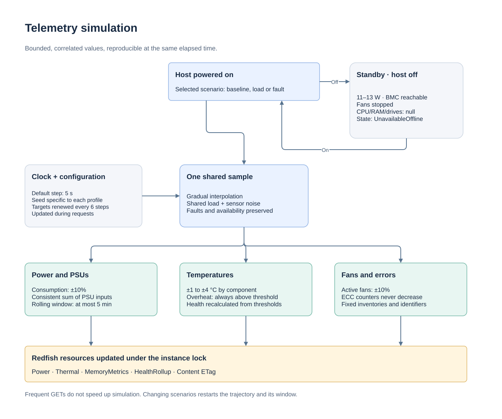

# Hardware monitoring and KPIs

[Documentation](readme.md) · [API](api.md) · [Deployment](deployment.md)

The Dell, HPE and Supermicro mocks expose readings through the standard
Redfish links `Systems`, `Chassis`, `Power`, `Thermal`, `Memory/Metrics` and
`Storage/Drives`. Access uses Basic authentication or a Redfish session over
HTTP or HTTPS. The new fields are **synthetic test readings**, not captures
from these machines or vendor-certified safety thresholds.

## Available readings

The paths below are relative to the discovered chassis or system. The
identifier is `System.Embedded.1` for Dell and `1` for HPE and Supermicro.

| Area | Resource / fields | Purpose |
|---|---|---|
| Server power consumption | `Chassis/{id}/Power`, `PowerControl[].PowerConsumedWatts` | Power in W; starting point for energy and cost calculations |
| Power window | `PowerControl[].PowerMetrics`: average, minimum, maximum, `IntervalInMin` | Rolling aggregates over at most 5 minutes |
| Power supplies | `PowerSupplies[]`: input/output in W, capacity in W, AC voltage, efficiency, status | Load, losses, PSU failure |
| Redundancy | `Power.Redundancy[]`, members and status | Loss of tolerance to a PSU failure |
| Temperatures | `Thermal.Temperatures[]`: reading in °C, context, thresholds, status and `RelatedItem` | CPUs, each DIMM, drives, PSUs, system board, inlet and outlet air |
| Fans | `Thermal.Fans[]`: reading, unit, lower thresholds and status | Stopped, slow or absent fans |
| Voltages | `Power.Voltages[]`: V, thresholds and status | AC input for each PSU; existing Supermicro rails and VBAT battery |
| ECC memory | Each DIMM's `Metrics` link: `LifeTime.CorrectableECCErrorCount` and `UncorrectableECCErrorCount` | Correctable and uncorrectable error counters |
| Hardware health | `Status.Health`, `Status.HealthRollup`, CPU/RAM summaries and main OEM states | Fault severity and propagation |
| Drives / RAID | Health, `FailurePredicted`, capacity, `PredictedMediaLifeLeftPercent`, `Operations` | Predicted failure, SSD wear, RAID rebuild |
| Inventory / power state | Model, serial number, firmware, CPU, RAM, `PowerState` | Metric labels, installed capacity and host/BMC distinction |
| Logs | `LogServices` and `Entries` collections | Diagnosis of faults predefined in the fixtures |

New sensors have stable identifiers. `RelatedItem` points to the relevant
component; embedded objects, such as a PSU, use a JSON Pointer fragment
(`.../Power#/PowerSupplies/0`). An HTTP request retrieves the resource before
`#`, then the client resolves the fragment in the JSON.

| Initial profile | AC power consumption | Temperature sensors | DIMMs with ECC counters | Selected PSUs |
|---|---|---|---|---|
| Dell | 412 W | 28 | 16 | 2 × 800 W, one failed |
| HPE | 364 W | 27 | 16 | 2 × 800 W |
| Supermicro | 498 W | 24 | 12 | 2 × 750 W |

In this model, system power is the sum of the PSUs' **AC inputs**. DC outputs
use a simulated efficiency of 94%. These values do not represent a real
efficiency curve. The upstream Dell data mixed 398 W of output and 412 W of
input; the initial system value is now 412 W. Do not add system power to
PSU inputs: that would count it twice. System-level `PowerCapacityWatts`
indicates the single-PSU DC budget for the 1+1 configuration; the two rated
capacities do not double the redundant power budget.

HPE fans remain in **Percent**, Dell/Supermicro fans in **RPM**. Absent or
unavailable sensors remain distinct from a zero reading. HPE CPU temperatures
no longer retain the incorrect imported critical threshold of 0 °C: the
scenario uses 90/95 °C explicitly as test thresholds. Added RAM, drive and
PSU thresholds are also simulation parameters.

## Collect KPIs remotely

From the project directory:

```sh
python3 -m redfish_mock.monitor --url http://127.0.0.1:8001
python3 -m redfish_mock.monitor --url http://127.0.0.1:8002
python3 -m redfish_mock.monitor --url http://127.0.0.1:8003
```

The example performs only GET requests on Redfish resources, following links.
It returns a JSON snapshot timestamped by the collector: power, efficiency,
redundancy, maximum temperatures by context, outlet/inlet air difference,
margin below the critical threshold, ECC errors, fan/drive faults, SSD wear
and RAID operation progress. A negative margin indicates a threshold breach.
Unavailable readings remain unknown rather than becoming zero.

Credentials come from `REDFISH_USERNAME` and `REDFISH_PASSWORD` (local defaults:
`admin`/`admin`). For HTTPS, TLS validation remains enabled;
`--ca-file certs/cert.pem` specifies the lab's certificate authority. Redirects
and links to another host are rejected. This example targets the supplied
profiles; it is neither a comprehensive multi-vendor collector nor a Prometheus
server. Failed collection returns a nonzero exit code.

Compose listens locally by default. For a collector on another lab machine,
set `REDFISH_BIND_ADDRESS` in `.env` to the server machine's LAN address
(or `0.0.0.0`), then rerun `docker compose up -d --wait`. The collector then
uses `http://ADDRESS:8001`, `:8002` or `:8003`. Python mode also accepts
`--host 0.0.0.0`, with `--cert` and `--key` for HTTPS. The currently started
ports remain bound to `127.0.0.1`.

## KPIs to calculate across multiple collections

| KPI | Calculation / consideration |
|---|---|
| Energy (kWh) | Integrate W over time: average of two samples × seconds / 3,600,000; flag collection gaps |
| Cost | Energy × price per kWh, configured in the monitoring system |
| Thermal margin | Critical threshold − temperature, for each valid sensor |
| Air temperature rise | Outlet temperature − inlet temperature |
| PSU efficiency | 100 × sum of DC outputs / sum of AC inputs, when the denominator is positive |
| PSU load | 100 × PSU DC output / that PSU's rated DC capacity |
| ECC errors per hour | Counter change / elapsed time; treat a decrease as a reset |
| BMC availability | Successful collections / expected collections; distinct from OS or host power state |
| Alerts | Lost redundancy, exceeded thermal threshold, predicted failure, uncorrectable ECC errors, low SSD remaining life |

## Reproducible scenarios

`GET /_mock` describes enabled scenarios. The following control route belongs
to the mock; the resulting readings remain available in Redfish resources:

```sh
curl -u admin:admin -H 'Content-Type: application/json' \
  -d '{"Scenario":"overheat"}' http://127.0.0.1:8001/_mock/scenario
python3 -m redfish_mock.monitor --url http://127.0.0.1:8001
curl -u admin:admin -H 'Content-Type: application/json' \
  -d '{"Scenario":"baseline"}' http://127.0.0.1:8001/_mock/scenario
```

| Scenario | Monitoring state |
|---|---|
| `baseline` | Initial enriched state, with rackhands faults preserved |
| `normal` | 300 W, CPU temperatures at 50 °C, working fans and PSUs |
| `high-load` | 620 W, increased temperatures and fan speeds |
| `overheat` | 620 W, first CPU 2 °C above the critical threshold |
| `psu-failure` | 300 W, second PSU failed, first PSU carrying the load |
| `fan-failure` | 300 W, first fan stopped and critical |
| `memory-errors` | 300 W, first DIMM critical, 12 correctable errors and 1 uncorrectable error |

Each selection first restores the monitoring snapshot, including ECC counters:
this changes the test dataset rather than continuing a monotonic hardware
counter history. Existing storage and VBAT battery faults remain; even
`normal` therefore does not guarantee an overall healthy server. Health
summaries and the main OEM power/fan states are updated. The `_steps`
sequences remain independent.

## Automatic variations



[Draw.io source](assets/monitoring-cycle.drawio).

Telemetry changes **every 5 seconds by default**. Each profile has an independent
random seed. Values change gradually between random targets, renewed every
six samples. Power, fan speeds and temperatures share a load variation;
temperatures also have a small variation specific to each sensor.

| Reading | Simulation range |
|---|---|
| Initial Dell power | 370.8–453.2 W (412 W ±10%) |
| Initial HPE power | 327.6–400.4 W (364 W ±10%) |
| Initial Supermicro power | 448.2–547.8 W (498 W ±10%) |
| `normal`, PSU/fan failures, memory errors | 270–330 W |
| `high-load`, `overheat` | 558–682 W |
| Standby with host off | 11–13 W |
| CPU temperature | Initial scenario value ±4 °C |
| Inlet air / drives / other sensors | ±1 / ±2 / ±3 °C respectively |
| First CPU during overheating | Always between 1 and 4 °C above the critical threshold |
| Working fans | ±10%, rounded; at most 100% for HPE |
| AC voltage of an active PSU | 228–232 V |

These limits are test parameters, not vendor-certified ranges. Efficiency
remains fixed at 94%. Failed PSUs stay at 0 W; absent or failed fans do not
receive random values. Thermal states are recalculated from thresholds.
Inventory, identifiers, capacities, SSD wear and predefined RAID operations
remain fixed. In `memory-errors`, one correctable error is added every six
samples; the uncorrectable counter remains at 1. Counters do not decrease
during this scenario, except on reset or when changing the test dataset.

Updates are calculated during requests, based on elapsed time, under the
server lock. A client polling frequently therefore does not accelerate the
simulation. Resources use the same sample until the next interval; collection
across an interval boundary may see two samples. ETags reflect the new values.

`PowerMetrics` describes **simulated** history since the scenario began,
limited to the last five full minutes of sampling. `IntervalInMin` indicates
the duration actually represented (0 at startup). The average is weighted by
the duration of completed samples; min/max also include the current reading.
Intermediate samples are reproducible even without requests. There is no
native energy counter or persistent history.

```sh
# Replay the same values at the same elapsed time, with a 2-second step:
python3 -m redfish_mock --fleet --metric-interval 2 --seed 42

# Keep the fixed values and scenarios from the previous mode:
python3 -m redfish_mock --fleet --static-metrics
```

The step accepts an integer from 1 to 60 seconds. With Docker, set
`REDFISH_METRIC_INTERVAL=5` and optionally `REDFISH_SEED=42` in `.env`, then
rerun `docker compose up -d --wait`. Without an explicit seed, each startup
chooses a new one; `GET /_mock` exposes the effective seed and step. Each
scenario selection or `/_mock/reset` restarts the trajectory and its window.
A manual override defines new starting values. In `--static-metrics` mode,
statistics remain a synthetic five-minute plateau.

A Redfish shutdown keeps the BMC accessible: 11–13 W standby power (12 W in
static mode), stopped fans, and CPU/RAM/drive temperatures set to `null` with
state `UnavailableOffline`. Powering back on restores the previous scenario
and restarts the power window without shifting its consumption range.
Transitions are instantaneous. Changing scenarios requires a powered-on host.
`POST /_mock/reset` fully restores the profile and revokes sessions.
`--raw-fixtures` disables these additions.

## References and limitations

- [Dell: power monitoring with iDRAC](https://www.dell.com/en-us/infohub/articles/server-power-consumption-reporting-and-management)
  and the [R750 guide](https://i.dell.com/sites/csdocuments/product_docs/en/poweredge-r750-technical-guide.pdf):
  remote collection and the 800 W PSU option in a 1+1 configuration.
- [HPE iLO 5: Power / Thermal](https://servermanagementportal.ext.hpe.com/docs/redfishservices/ilos/ilo5/ilo5_306/ilo5_other_resourcedefns306)
  and [aggregate states](https://servermanagementportal.ext.hpe.com/docs/redfishservices/ilos/ilo5/ilo5_306/ilo5_computersystem_resourcedefns306):
  power properties, temperatures, units and redundancy states.
- [Supermicro FAQ 44559](https://www.supermicro.com/es-es/support/faqs/faq.php?faq=44559):
  Power/Thermal routes for monitoring temperatures, fans and PSUs.
  [SYS-6019U-TR4](https://www.supermicro.com/en/products/system/1u/6019/sys-6019u-tr4.php): 750 W PSUs.
- DMTF schemas: [Power 1.7.1](https://github.com/DMTF/Redfish-Publications/blob/main/json-schema/Power.v1_7_1.json),
  [Thermal 1.7.0](https://github.com/DMTF/Redfish-Publications/blob/main/json-schema/Thermal.v1_7_0.json),
  [MemoryMetrics 1.4.0](https://github.com/DMTF/Redfish-Publications/blob/main/json-schema/MemoryMetrics.v1_4_0.json)
  and [Redundancy 1.4.0](https://github.com/DMTF/Redfish-Publications/blob/main/json-schema/Redundancy.v1_4_0.json).

The standard ECC counters and individual sensors added here are a simulation
extension: their presence at these locations is not certified for every real
firmware version. The documents establish the structure and meaning of the
fields, not the simulated values. No new proprietary OEM API is invented.
OS CPU/RAM utilization, IOPS, network throughput and used disk space are not
simulated: they require an OS/hypervisor source or validated OEM telemetry.
No push events, persistent history or dashboard are included.
