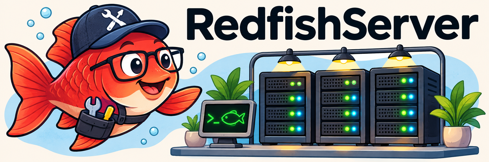

# RedfishServer



A local HTTP/HTTPS server for testing Redfish clients with Dell iDRAC, HPE iLO
and Supermicro profiles. Lenovo and HPE iLO 4 are available as optional profiles.
The engine runs on Python 3.14 with a bounded Uvicorn ASGI transport.
Dependencies and container bases are pinned for reproducible releases.

The data is synthetic, and state is kept in memory.

## Quick start

With Docker Compose:

```sh
docker compose up --build -d --wait
```

Or with Python, from the project root:

```sh
uv run --frozen python -m redfish_mock --fleet
```

Choose one launch method: both use the same ports.

| Profile | Local URL |
|---|---|
| Dell | http://127.0.0.1:8001/redfish/v1/ |
| HPE | http://127.0.0.1:8002/redfish/v1/ |
| Supermicro | http://127.0.0.1:8003/redfish/v1/ |

Development credentials: `admin` / `admin`. For internal production, use the
separate [production configuration](docs/production.md), which requires a secret
file and explicit credentials.

```sh
curl -u admin:admin http://127.0.0.1:8001/redfish/v1/Systems
```

To stop: `docker compose --profile extras down` or `Ctrl+C` in Python mode.
Changes held in memory are lost on restart.

## Documentation

Full documentation is available in [docs/](docs/readme.md):

- [Internal production and release](docs/production.md)
- [Deployment and configuration](docs/deployment.md)
- [API and examples](docs/api.md)
- [Monitoring and simulation](docs/monitoring.md)
- [CPU and memory inventories](docs/inventory.md)
- [Architecture](docs/architecture.md)
- [Sources and limitations](docs/fidelity.md)
- [Development and checks](docs/development.md)
